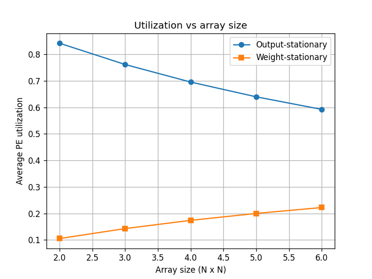
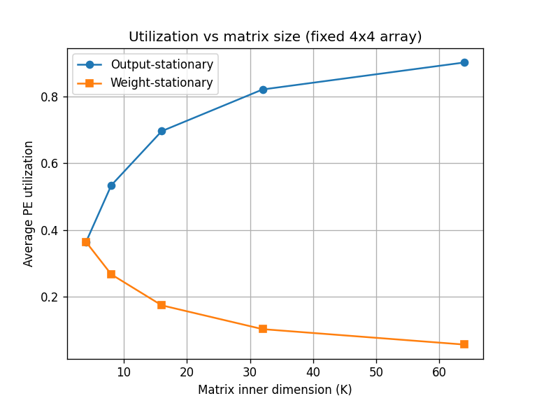
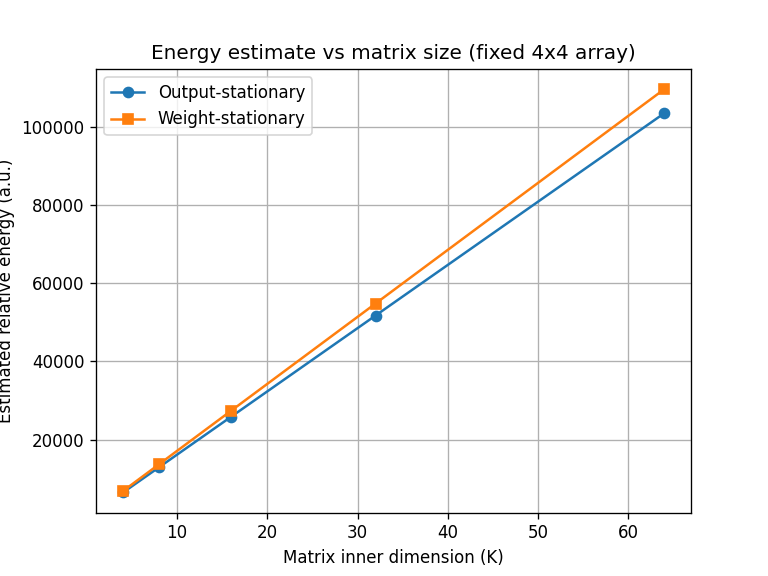

# Systolic Array Architecture Simulator

A cycle-accurate Python simulator of systolic array dataflows — the
architecture underlying hardware accelerators such as Google's TPU and
NVIDIA's Tensor Cores.

## Overview

This project models a grid of Processing Elements (PEs) at cycle-level
granularity, implementing two distinct dataflow strategies used in
accelerator design: output-stationary and weight-stationary.

## Features

- Output-stationary and weight-stationary dataflow implementations
- Support for rectangular array configurations (M×K · K×N → M×N), not
  limited to square arrays
- Correctness validated against a reference matrix multiplication
  implementation across 50 randomized test cases
- A relative energy model comparing DRAM, on-chip memory, and compute
  cost across both dataflows

## Results





## Usage

```bash
python systolic_sim.py
```